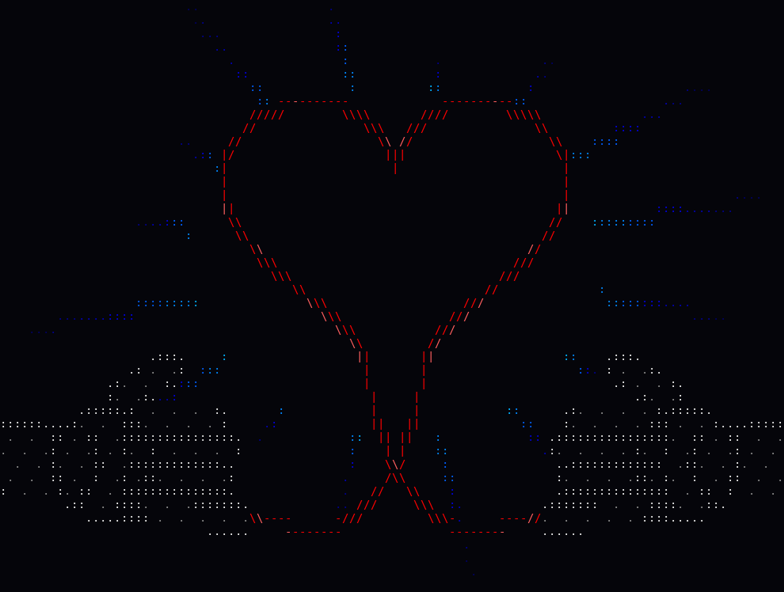

# Manos conectadas 🧵❤️

"Red string theory" en Python: dos manos unidas por el hilo rojo del destino, que se cruza y forma un corazón que late. Animación ASCII en la terminal, sin dependencias.



## Ejecutar

```bash
python manos_conectadas.py
```

`Ctrl+C` para salir. Usa una terminal de al menos 110×44 caracteres con colores (Windows Terminal, VS Code, macOS/Linux).
